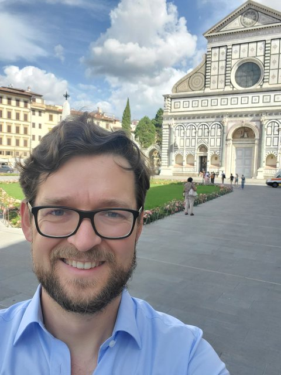

# AI-Era.co — Architectural Header, Mobile Overhaul, Content & Interior Pages Specification

**Target Objective:** 
1. Replace the floating header with a **solid, collision-proof editorial masthead bar (Fix 2)** in normal document flow above the island canvas.
2. Fix the **mobile phone experience (`<= 768px`)**, addressing viewport height clipping, overlapping absolute elements, microscopic/colliding SVG pill labels, and the inspection drawer layout.
3. Unify the `Harbor Stoa · /about` profile with the four core profiles, remove deprecated DOM blocks, add `"Enter →"` buttons, and scaffold the five interior subpages (`/strategist/`, `/builder/`, `/philosopher/`, `/practitioner/`, and `/about/`).

---

## Part 0: Mobile Viewport Simulation (390 × 844 px Phone Screen Diagnosis)

When simulating the current `index.html` on a standard mobile viewport (e.g., Pixel / iPhone at `390px` width), five structural failures occur:

| Mobile Issue | Root Cause in Current Layout | Required Fix |
|---|---|---|
| **1. Header & Nav Collision** | `header` and the `Polis Map \| Card Grid \| About Me \| Day` pill are `position: absolute` at the top of the screen, crashing into each other and covering the top 35% of the canvas on narrow screens. | Move `<header role="banner">` into normal document flow (`position: relative`) as a dedicated parchment top bar (`#f5efe2`) that stacks cleanly on mobile: Title/Subtitle on top, centered full-width segmented nav pill below. |
| **2. Landscape SVG Crushed into a Tiny Strip** | The isometric island is wide (`16:10` aspect ratio). Fitting its width into `390px` shrinks the island to a ~230px-tall band while leaving giant empty teal bars or getting covered by the drawer. | On mobile (`<= 768px`), place the SVG map in a dedicated top stage (`height: 44vh; min-height: 300px;`) with `preserveAspectRatio="xMidYMid meet"` (or slight zoom `transform: scale(1.12)`) so the island fills the mobile frame cleanly. |
| **3. Building Pills Overflow / Overlap** | Long labels like `Garden in the Citadel - /philosopher` are too wide for a `390px` screen, colliding with neighboring buildings or clipping off the screen edge. | On mobile (`<= 768px`), compact the floating map pills (smaller font `0.68rem`, tighter padding) or hide the secondary `- /slug` inside the map pill so only `Acropolis`, `Artisan Forge`, `Garden`, `Horologion`, and `Harbor Stoa` appear on the illustration (the full `/slug` still appears in the drawer below!). |
| **4. Drawer Covers the Island** | A floating right-hand `<aside>` drawer on desktop becomes an overlapping modal on mobile that blocks the user from tapping the buildings. | On mobile (`<= 768px`), convert the main Polis view into a **vertical split-screen (`flex-direction: column`)**: the interactive island map sits on the top half, and the `<aside>` inspection card docks cleanly underneath it as a grounded bottom sheet in normal flow. |
| **5. Fixed `100vh` Clipping** | Desktop `height: 100vh; overflow: hidden` traps mobile users when the subtitle, map, and drawer exceed 844px of vertical height. | On mobile (`<= 768px`), set `body, main { height: auto; min-height: 100dvh; overflow-y: auto; }` so the page scrolls naturally without clipping the `"Enter →"` button. |

---

## Part 1: Root `index.html` — Header Bar (Fix 2) & Responsive Mobile Layout

### 1.1 HTML Structure for the Solid Top Masthead (`<header role="banner">`)

Replace the floating header with this structured masthead bar situated **above** `<main>`:

```html
<header role="banner" class="site-header">
  <div class="header-inner">
    <div class="brand-masthead">
      <div class="brand-topline">
        <h1 class="brand-title">AI Era</h1>
        <span class="brand-divider" aria-hidden="true"></span>
        <span class="brand-kicker">THE POLIS &amp; CONCEPT LAB</span>
      </div>
      <p class="brand-question">
        How do we live well, build, and flourish in an AI-native world?
      </p>
      <p class="brand-inquiries">
        Four inquiries into civilizational history, ethical design, Stoic philosophy, and the craft of work.
      </p>
    </div>

    <nav class="site-nav" aria-label="Site navigation and view controls">
      <!-- Keep existing Polis Map | Card Grid | About Me | Day buttons here -->
    </nav>
  </div>
</header>
```

### 1.2 Complete Desktop + Mobile CSS for the Header, Map Stage, Pills & Drawer

Add or replace these rules in the `<style>` block of `index.html`:

```css
/* ==========================================================================
   1. GLOBAL & SKY BACKGROUND FIX (No light-blue seam above the SVG sky)
   ========================================================================== */
html, body {
  margin: 0;
  padding: 0;
  background-color: #f5efe2; /* Matches the warm parchment sky */
  color: #1f1e1b;
  -webkit-text-size-adjust: 100%;
}

/* ==========================================================================
   2. DEDICATED ARCHITECTURAL HEADER BAR (Fix 2 — Desktop & Mobile)
   ========================================================================== */
header[role="banner"],
.site-header {
  position: relative !important;
  top: auto !important;
  left: auto !important;
  right: auto !important;
  width: 100%;
  background: #f5efe2;
  border-bottom: 1px solid rgba(31, 30, 27, 0.12);
  padding: 1.1rem 2rem;
  z-index: 30;
  box-sizing: border-box;
}

.header-inner {
  max-width: 1440px;
  margin: 0 auto;
  display: flex;
  justify-content: space-between;
  align-items: center;
  gap: 1.5rem;
}

.brand-masthead {
  background: transparent !important;
  border: none !important;
  box-shadow: none !important;
  padding: 0 !important;
  max-width: 680px;
}

.brand-topline {
  display: flex;
  align-items: baseline;
  gap: 0.65rem;
  margin-bottom: 0.25rem;
  flex-wrap: wrap;
}

.brand-title {
  font-family: Georgia, "Times New Roman", serif;
  font-size: clamp(1.65rem, 2.4vw, 2.15rem);
  font-weight: 700;
  letter-spacing: -0.02em;
  color: #1f1e1b;
  margin: 0;
  line-height: 1;
}

.brand-divider {
  width: 1px;
  height: 0.9rem;
  background: rgba(31, 30, 27, 0.25);
  align-self: center;
}

.brand-kicker {
  font-size: 0.72rem;
  font-weight: 700;
  letter-spacing: 0.13em;
  text-transform: uppercase;
  color: #9c5a25;
}

.brand-question {
  font-family: Georgia, "Times New Roman", serif;
  font-size: clamp(1rem, 1.3vw, 1.15rem);
  font-weight: 700;
  color: #1f1e1b;
  line-height: 1.3;
  margin: 0 0 0.15rem 0;
}

.brand-inquiries {
  font-size: clamp(0.84rem, 1.05vw, 0.94rem);
  color: rgba(31, 30, 27, 0.75);
  line-height: 1.4;
  margin: 0;
}

.site-nav {
  flex-shrink: 0;
}

/* ==========================================================================
   3. POLIS STAGE & INSPECTION DRAWER (Desktop Default)
   ========================================================================== */
.polis-canvas,
.island-stage,
main > div > section:first-child {
  padding-top: 0 !important;
}

.card-actions {
  margin-top: 1.25rem;
  display: flex;
  justify-content: flex-end;
}

.enter-btn {
  display: inline-flex;
  align-items: center;
  gap: 0.4rem;
  padding: 0.5rem 1.05rem;
  font-size: 0.82rem;
  font-weight: 600;
  letter-spacing: 0.05em;
  text-transform: uppercase;
  text-decoration: none;
  color: inherit;
  border: 1px solid currentColor;
  border-radius: 999px;
  opacity: 0.9;
  transition: opacity 0.2s ease, transform 0.2s ease, background-color 0.2s ease;
}

.enter-btn:hover {
  opacity: 1;
  transform: translateX(2px);
  background-color: rgba(0, 0, 0, 0.06);
}

/* ==========================================================================
   4. MOBILE & TABLET RESPONSIVE OVERHAUL (<= 768px)
   ========================================================================== */
@media (max-width: 768px) {
  /* Allow natural vertical scrolling so nothing gets clipped */
  html, body, main {
    height: auto !important;
    min-height: 100dvh;
    overflow-x: hidden;
    overflow-y: auto !important;
  }

  /* Compact stacked header on phone screens */
  header[role="banner"],
  .site-header {
    padding: 0.9rem 1rem 0.85rem;
  }

  .header-inner {
    flex-direction: column;
    align-items: stretch;
    gap: 0.75rem;
  }

  .brand-title {
    font-size: 1.5rem;
  }

  .brand-kicker {
    font-size: 0.64rem;
    letter-spacing: 0.1em;
  }

  .brand-question {
    font-size: 0.98rem;
    line-height: 1.32;
  }

  .brand-inquiries {
    font-size: 0.82rem;
    line-height: 1.38;
  }

  /* Center and fit the navigation control bar across the mobile width */
  .site-nav {
    width: 100%;
    display: flex;
    justify-content: center;
    overflow-x: auto;
    -webkit-overflow-scrolling: touch;
  }

  .site-nav > * {
    font-size: 0.76rem !important;
    padding: 0.35rem 0.65rem !important;
    white-space: nowrap;
  }

  /* Stack Polis Map on top, Active Building Card docked cleanly underneath */
  .polis-layout,
  .polis-view,
  main > div {
    display: flex !important;
    flex-direction: column !important;
    height: auto !important;
  }

  /* Give the isometric island a generous, un-crushed viewport stage */
  .polis-canvas,
  .island-stage,
  .map-container {
    position: relative !important;
    width: 100% !important;
    height: 44vh !important;
    min-height: 290px !important;
    max-height: 380px !important;
    overflow: hidden;
    background: #1f5c6e; /* Deep Aegean sea fill behind SVG */
  }

  /* Slight zoom on mobile so the diamond island fills the 390px width */
  .polis-canvas svg,
  .island-stage svg,
  .map-container svg {
    width: 100% !important;
    height: 100% !important;
    object-fit: cover;
    transform: scale(1.12);
    transform-origin: center center;
  }

  /* Prevent building pills on the map from overlapping on a 390px screen */
  .building-pill,
  .map-label,
  [data-building] .pill {
    font-size: 0.66rem !important;
    padding: 2px 7px !important;
    white-space: nowrap;
  }

  /* Dock the <aside> drawer directly below the map as a clean card sheet */
  aside[aria-live="polite"] {
    position: relative !important;
    top: auto !important;
    right: auto !important;
    bottom: auto !important;
    left: auto !important;
    width: 100% !important;
    max-width: 100% !important;
    margin: 0 !important;
    border-radius: 0 !important;
    border-top: 2px solid rgba(31, 30, 27, 0.15) !important;
    background: #f6f3ec !important;
    padding: 1.25rem 1.25rem 2rem !important;
    box-shadow: none !important;
    box-sizing: border-box;
    z-index: 10;
  }

  /* Make the Enter button a full-width or prominent tap target on mobile */
  .card-actions {
    margin-top: 1rem;
  }

  .enter-btn {
    padding: 0.6rem 1.2rem;
    font-size: 0.85rem;
  }

  /* Single-column Bento Grid on mobile */
  .bento-grid {
    grid-template-columns: 1fr !important;
    padding: 1rem !important;
    gap: 1rem !important;
  }
}
```

---

## Part 2: DOM Cleanup & Unified 5 Building Profiles

### 2.1 Remove Deprecated DOM Elements

1. **Remove the hidden Manifesto view:** Delete the leftover `<div hidden>` block containing `Manifesto & Field Notes` (`aria-label="AI Era Manifesto"`) inside `<main>`.
2. **Remove the separate hidden `About Me` drawer panel:** Inside the Polis `<aside aria-live="polite">`, delete the special `<div hidden>` that holds the old 3-part third-person `Harbor Stoa · /about` bio. Instead, `about` must be rendered dynamically using the exact same `<aside>` title, body, tag, and action link structure as `strategist`, `builder`, `philosopher`, and `practitioner`.

### 2.2 Fix Copy Mechanics & Unify All 5 Building Profiles

Update the JavaScript data object / state dictionary that powers both the **Interactive Polis `<aside>` drawer** and the **Classic Bento Card Grid** so that all five buildings use the exact text and `href` routes below:

```javascript
const BUILDINGS = {
  strategist: {
    tag: "Acropolis - /strategist",
    shortLabel: "The Next Gateway",
    title: "The Strategist: The Next Gateway",
    body: "Some thresholds only open one way. Humanity did not go back on agriculture, or the mechanical engine. I'm a historian by training, and I think we are standing in front of another one-way gateway. For decades innovation has felt like a Red Queen's Race: ever more effort to stay roughly where we are. Is AI the exit? I don't know yet. The Next Gateway is where I work on that question.",
    href: "/strategist/"
  },
  builder: {
    tag: "Artisan Forge - /builder",
    shortLabel: "Applied AI Ethics",
    title: "The Builder: Applied AI Ethics",
    body: "Most AI ethics tells you what not to build. I keep getting stuck on the question it leaves open: what is an ethical AI product good for? My working answer is that it should leave people with more agency, mastery, and judgment than they had before. In an era where AI can build anything, should we start focusing on products that foster internal goods? I test that answer with my students at CU Boulder and in my own product work. Here is where it stands, and where it still breaks.",
    href: "/builder/"
  },
  philosopher: {
    tag: "Garden in the Citadel - /philosopher",
    shortLabel: "Garden in the Citadel",
    title: "The Philosopher: Garden in the Citadel",
    body: "Stoicism has always been the philosophy of turbulent times. It was born as Alexander’s empire came apart, and Marcus Aurelius wrote his Meditations between plague and frontier wars. It is finding its readers again in the AI era. But the Stoicism most people meet is the inner citadel: the mind as a fortress nothing external can breach. I think that is only half the picture. A fortress protects; it doesn’t flourish. Flourishing comes from tending a garden inside the walls. What belongs in that garden is the question I keep bringing to the timeless works of Stoic philosophy.",
    href: "/philosopher/"
  },
  practitioner: {
    tag: "Horologion - /practitioner",
    shortLabel: "Kairos OS",
    title: "The Practitioner: Kairos OS",
    body: "The Greeks had two words for time. Chronos is the clock: schedules, backlogs, throughput. Kairos is the right moment, and the nerve to act on it. Machines are about to own Chronos. So what is left for us? My bet is two things. Commitment, because nothing is at stake for a machine. And curiosity, because if AI really is a gateway, nobody has a map of the far side, and exploring is the best thing we bring to it. Kairos OS is the system I’m building to test that bet on my own working days. Some of it works, some doesn’t yet. I write up both.",
    href: "/practitioner/"
  },
  about: {
    tag: "Harbor Stoa - /about",
    shortLabel: "About Me",
    title: "Harbor Stoa: About Me",
    body: "I’m Nikolaus Klassen. My path to the AI era started in the humanities, with a PhD in Classics and Cultural History studying how societies adapt old patterns of thought when their world shifts. Today, I’m a Technical Program Manager at Google, where I help build and deploy agentic AI systems. Between those two worlds, I teach Applied AI Ethics at CU Boulder. Across ancient texts, modern data pipelines, and autonomous agents, I’m drawn to the same underlying question: how do we turn raw information into knowledge we trust and act upon? This island is my workshop for thinking in public across all three roles.",
    href: "/about/"
  }
};
```

### 2.3 Add the `"Enter"` Button to the Polis Drawer & Bento Cards

#### HTML Structure for the Polis `<aside>` Drawer:

```html
<aside aria-live="polite">
  <div>
    <span id="drawer-tag">Acropolis - /strategist</span>
  </div>
  <div>
    <h2 id="drawer-title">The Strategist: The Next Gateway</h2>
    <p id="drawer-body">
      Some thresholds only open one way. Humanity did not go back on agriculture, or the mechanical engine. I'm a historian by training, and I think we are standing in front of another one-way gateway. For decades innovation has felt like a Red Queen's Race: ever more effort to stay roughly where we are. Is AI the exit? I don't know yet. The Next Gateway is where I work on that question.
    </p>
    <div class="card-actions">
      <a id="drawer-link" href="/strategist/" class="enter-btn">Enter &rarr;</a>
    </div>
  </div>
</aside>
```

*Ensure the JavaScript click/selection handler updates `document.getElementById('drawer-link').href = building.href;` whenever a building is selected on the map (and when `"About Me"` is clicked in the top navigation bar).*

#### HTML Structure for Each Classic Bento Card (`<article>`):

```html
<article class="bento-card">
  <div class="bento-meta">
    <span>Harbor Stoa</span>
    <span>/about</span>
  </div>
  <h3>Harbor Stoa: About Me</h3>
  <p>
    I’m Nikolaus Klassen. My path to the AI era started in the humanities, with a PhD in Classics and Cultural History studying how societies adapt old patterns of thought when their world shifts. Today, I’m a Technical Program Manager at Google, where I help build and deploy agentic AI systems. Between those two worlds, I teach Applied AI Ethics at CU Boulder. Across ancient texts, modern data pipelines, and autonomous agents, I’m drawn to the same underlying question: how do we turn raw information into knowledge we trust and act upon? This island is my workshop for thinking in public across all three roles.
  </p>
  <div class="card-actions">
    <a href="/about/" class="enter-btn">Enter &rarr;</a>
  </div>
</article>
```

---

## Part 3: Directory Structure & Interior Pages

Create five subdirectories at the repository root so GitHub Pages serves clean URLs (`/strategist/`, `/builder/`, `/philosopher/`, `/practitioner/`, `/about/`):

```text
/ (repo root)
├── index.html
├── assets/
│   └── profile.jpg          # Portrait image for /about/
├── strategist/
│   └── index.html
├── builder/
│   └── index.html
├── philosopher/
│   └── index.html
├── practitioner/
│   └── index.html
└── about/
    └── index.html
```

### 3.1 `/strategist/index.html`

```html
<!DOCTYPE html>
<html lang="en">
<head>
  <meta charset="UTF-8" />
  <meta name="viewport" content="width=device-width, initial-scale=1.0" />
  <title>The Strategist: The Next Gateway · AI Era</title>
  <style>
    :root {
      --bg: #f6f3ec;
      --surface: #efeae0;
      --text: #1f1e1b;
      --muted: #656158;
      --accent: #8c5a32;
      --border: rgba(31, 30, 27, 0.14);
    }
    * { box-sizing: border-box; }
    body {
      margin: 0;
      background: var(--bg);
      color: var(--text);
      font-family: -apple-system, BlinkMacSystemFont, "Segoe UI", Roboto, Georgia, serif;
      line-height: 1.65;
      padding: 2rem 1.25rem 4rem;
    }
    .container { max-width: 720px; margin: 0 auto; }
    .back-link {
      display: inline-block;
      color: var(--muted);
      text-decoration: none;
      font-size: 0.9rem;
      letter-spacing: 0.02em;
      margin-bottom: 2rem;
    }
    .back-link:hover { color: var(--text); }
    .eyebrow {
      font-size: 0.8rem;
      text-transform: uppercase;
      letter-spacing: 0.1em;
      color: var(--accent);
      font-weight: 600;
      margin-bottom: 0.5rem;
    }
    h1 {
      font-size: clamp(1.75rem, 4vw, 2.5rem);
      line-height: 1.2;
      margin: 0 0 1.25rem;
    }
    .lead {
      font-size: 1.08rem;
      color: var(--text);
      margin-bottom: 2.25rem;
      padding-bottom: 1.75rem;
      border-bottom: 1px solid var(--border);
    }
    .coming-soon-box {
      background: var(--surface);
      border: 1px solid var(--border);
      border-radius: 12px;
      padding: 1.75rem 1.25rem;
      text-align: center;
      color: var(--muted);
    }
    .coming-soon-box strong {
      display: block;
      color: var(--text);
      font-size: 1.05rem;
      margin-bottom: 0.35rem;
    }
  </style>
</head>
<body>
  <main class="container">
    <a href="/" class="back-link">&larr; Return to the Polis</a>
    <div class="eyebrow">Acropolis · /strategist</div>
    <h1>The Strategist: The Next Gateway</h1>
    <p class="lead">
      Some thresholds only open one way. Humanity did not go back on agriculture, or the mechanical engine. I'm a historian by training, and I think we are standing in front of another one-way gateway. For decades innovation has felt like a Red Queen's Race: ever more effort to stay roughly where we are. Is AI the exit? I don't know yet. The Next Gateway is where I work on that question.
    </p>
    <section class="coming-soon-box" aria-label="Status">
      <strong>Content coming soon</strong>
      Essays, chapters, and working notes for <em>The Next Gateway?</em> are currently being prepared.
    </section>
  </main>
</body>
</html>
```

### 3.2 `/builder/index.html`

```html
<!DOCTYPE html>
<html lang="en">
<head>
  <meta charset="UTF-8" />
  <meta name="viewport" content="width=device-width, initial-scale=1.0" />
  <title>The Builder: Applied AI Ethics · AI Era</title>
  <style>
    :root {
      --bg: #f6f3ec;
      --surface: #efeae0;
      --text: #1f1e1b;
      --muted: #656158;
      --accent: #8c5a32;
      --border: rgba(31, 30, 27, 0.14);
    }
    * { box-sizing: border-box; }
    body {
      margin: 0;
      background: var(--bg);
      color: var(--text);
      font-family: -apple-system, BlinkMacSystemFont, "Segoe UI", Roboto, Georgia, serif;
      line-height: 1.65;
      padding: 2rem 1.25rem 4rem;
    }
    .container { max-width: 720px; margin: 0 auto; }
    .back-link {
      display: inline-block;
      color: var(--muted);
      text-decoration: none;
      font-size: 0.9rem;
      letter-spacing: 0.02em;
      margin-bottom: 2rem;
    }
    .back-link:hover { color: var(--text); }
    .eyebrow {
      font-size: 0.8rem;
      text-transform: uppercase;
      letter-spacing: 0.1em;
      color: var(--accent);
      font-weight: 600;
      margin-bottom: 0.5rem;
    }
    h1 {
      font-size: clamp(1.75rem, 4vw, 2.5rem);
      line-height: 1.2;
      margin: 0 0 1.25rem;
    }
    .lead {
      font-size: 1.08rem;
      color: var(--text);
      margin-bottom: 2.25rem;
      padding-bottom: 1.75rem;
      border-bottom: 1px solid var(--border);
    }
    .coming-soon-box {
      background: var(--surface);
      border: 1px solid var(--border);
      border-radius: 12px;
      padding: 1.75rem 1.25rem;
      text-align: center;
      color: var(--muted);
    }
    .coming-soon-box strong {
      display: block;
      color: var(--text);
      font-size: 1.05rem;
      margin-bottom: 0.35rem;
    }
  </style>
</head>
<body>
  <main class="container">
    <a href="/" class="back-link">&larr; Return to the Polis</a>
    <div class="eyebrow">Artisan Forge · /builder</div>
    <h1>The Builder: Applied AI Ethics</h1>
    <p class="lead">
      Most AI ethics tells you what not to build. I keep getting stuck on the question it leaves open: what is an ethical AI product good for? My working answer is that it should leave people with more agency, mastery, and judgment than they had before. In an era where AI can build anything, should we start focusing on products that foster internal goods? I test that answer with my students at CU Boulder and in my own product work. Here is where it stands, and where it still breaks.
    </p>
    <section class="coming-soon-box" aria-label="Status">
      <strong>Content coming soon</strong>
      Frameworks, syllabus notes, and design patterns for <em>AI Ethics as a Design Language</em> are currently being prepared.
    </section>
  </main>
</body>
</html>
```

### 3.3 `/philosopher/index.html`

```html
<!DOCTYPE html>
<html lang="en">
<head>
  <meta charset="UTF-8" />
  <meta name="viewport" content="width=device-width, initial-scale=1.0" />
  <title>The Philosopher: Garden in the Citadel · AI Era</title>
  <style>
    :root {
      --bg: #f6f3ec;
      --surface: #efeae0;
      --text: #1f1e1b;
      --muted: #656158;
      --accent: #8c5a32;
      --border: rgba(31, 30, 27, 0.14);
    }
    * { box-sizing: border-box; }
    body {
      margin: 0;
      background: var(--bg);
      color: var(--text);
      font-family: -apple-system, BlinkMacSystemFont, "Segoe UI", Roboto, Georgia, serif;
      line-height: 1.65;
      padding: 2rem 1.25rem 4rem;
    }
    .container { max-width: 720px; margin: 0 auto; }
    .back-link {
      display: inline-block;
      color: var(--muted);
      text-decoration: none;
      font-size: 0.9rem;
      letter-spacing: 0.02em;
      margin-bottom: 2rem;
    }
    .back-link:hover { color: var(--text); }
    .eyebrow {
      font-size: 0.8rem;
      text-transform: uppercase;
      letter-spacing: 0.1em;
      color: var(--accent);
      font-weight: 600;
      margin-bottom: 0.5rem;
    }
    h1 {
      font-size: clamp(1.75rem, 4vw, 2.5rem);
      line-height: 1.2;
      margin: 0 0 1.25rem;
    }
    .lead {
      font-size: 1.08rem;
      color: var(--text);
      margin-bottom: 2.25rem;
      padding-bottom: 1.75rem;
      border-bottom: 1px solid var(--border);
    }
    .coming-soon-box {
      background: var(--surface);
      border: 1px solid var(--border);
      border-radius: 12px;
      padding: 1.75rem 1.25rem;
      text-align: center;
      color: var(--muted);
    }
    .coming-soon-box strong {
      display: block;
      color: var(--text);
      font-size: 1.05rem;
      margin-bottom: 0.35rem;
    }
  </style>
</head>
<body>
  <main class="container">
    <a href="/" class="back-link">&larr; Return to the Polis</a>
    <div class="eyebrow">Garden in the Citadel · /philosopher</div>
    <h1>The Philosopher: Garden in the Citadel</h1>
    <p class="lead">
      Stoicism has always been the philosophy of turbulent times. It was born as Alexander’s empire came apart, and Marcus Aurelius wrote his Meditations between plague and frontier wars. It is finding its readers again in the AI era. But the Stoicism most people meet is the inner citadel: the mind as a fortress nothing external can breach. I think that is only half the picture. A fortress protects; it doesn’t flourish. Flourishing comes from tending a garden inside the walls. What belongs in that garden is the question I keep bringing to the timeless works of Stoic philosophy.
    </p>
    <section class="coming-soon-box" aria-label="Status">
      <strong>Content coming soon</strong>
      Essays and reflections from <em>Reading Marcus</em> and the Garden in the Citadel are currently being prepared.
    </section>
  </main>
</body>
</html>
```

### 3.4 `/practitioner/index.html`

```html
<!DOCTYPE html>
<html lang="en">
<head>
  <meta charset="UTF-8" />
  <meta name="viewport" content="width=device-width, initial-scale=1.0" />
  <title>The Practitioner: Kairos OS · AI Era</title>
  <style>
    :root {
      --bg: #f6f3ec;
      --surface: #efeae0;
      --text: #1f1e1b;
      --muted: #656158;
      --accent: #8c5a32;
      --border: rgba(31, 30, 27, 0.14);
    }
    * { box-sizing: border-box; }
    body {
      margin: 0;
      background: var(--bg);
      color: var(--text);
      font-family: -apple-system, BlinkMacSystemFont, "Segoe UI", Roboto, Georgia, serif;
      line-height: 1.65;
      padding: 2rem 1.25rem 4rem;
    }
    .container { max-width: 720px; margin: 0 auto; }
    .back-link {
      display: inline-block;
      color: var(--muted);
      text-decoration: none;
      font-size: 0.9rem;
      letter-spacing: 0.02em;
      margin-bottom: 2rem;
    }
    .back-link:hover { color: var(--text); }
    .eyebrow {
      font-size: 0.8rem;
      text-transform: uppercase;
      letter-spacing: 0.1em;
      color: var(--accent);
      font-weight: 600;
      margin-bottom: 0.5rem;
    }
    h1 {
      font-size: clamp(1.75rem, 4vw, 2.5rem);
      line-height: 1.2;
      margin: 0 0 1.25rem;
    }
    .lead {
      font-size: 1.08rem;
      color: var(--text);
      margin-bottom: 2.25rem;
      padding-bottom: 1.75rem;
      border-bottom: 1px solid var(--border);
    }
    .coming-soon-box {
      background: var(--surface);
      border: 1px solid var(--border);
      border-radius: 12px;
      padding: 1.75rem 1.25rem;
      text-align: center;
      color: var(--muted);
    }
    .coming-soon-box strong {
      display: block;
      color: var(--text);
      font-size: 1.05rem;
      margin-bottom: 0.35rem;
    }
  </style>
</head>
<body>
  <main class="container">
    <a href="/" class="back-link">&larr; Return to the Polis</a>
    <div class="eyebrow">Horologion · /practitioner</div>
    <h1>The Practitioner: Kairos OS</h1>
    <p class="lead">
      The Greeks had two words for time. Chronos is the clock: schedules, backlogs, throughput. Kairos is the right moment, and the nerve to act on it. Machines are about to own Chronos. So what is left for us? My bet is two things. Commitment, because nothing is at stake for a machine. And curiosity, because if AI really is a gateway, nobody has a map of the far side, and exploring is the best thing we bring to it. Kairos OS is the system I’m building to test that bet on my own working days. Some of it works, some doesn’t yet. I write up both.
    </p>
    <section class="coming-soon-box" aria-label="Status">
      <strong>Content coming soon</strong>
      System architecture notes, agent workflows, and field reports from <em>Kairos OS</em> are currently being prepared.
    </section>
  </main>
</body>
</html>
```

### 3.5 `/about/index.html` (Mobile-Friendly Portrait + Full CV)

```html
<!DOCTYPE html>
<html lang="en">
<head>
  <meta charset="UTF-8" />
  <meta name="viewport" content="width=device-width, initial-scale=1.0" />
  <title>About Nikolaus Klassen · AI Era</title>
  <style>
    :root {
      --bg: #f6f3ec;
      --surface: #efeae0;
      --text: #1f1e1b;
      --muted: #656158;
      --accent: #8c5a32;
      --border: rgba(31, 30, 27, 0.14);
    }
    * { box-sizing: border-box; }
    body {
      margin: 0;
      background: var(--bg);
      color: var(--text);
      font-family: -apple-system, BlinkMacSystemFont, "Segoe UI", Roboto, Georgia, serif;
      line-height: 1.65;
      padding: 2rem 1.25rem 4rem;
    }
    .container {
      max-width: 780px;
      margin: 0 auto;
    }
    .back-link {
      display: inline-block;
      color: var(--muted);
      text-decoration: none;
      font-size: 0.9rem;
      margin-bottom: 2rem;
    }
    .back-link:hover { color: var(--text); }
    .eyebrow {
      font-size: 0.8rem;
      text-transform: uppercase;
      letter-spacing: 0.1em;
      color: var(--accent);
      font-weight: 600;
      margin-bottom: 0.5rem;
    }
    .hero {
      display: grid;
      grid-template-columns: 180px 1fr;
      gap: 2rem;
      align-items: start;
      margin-bottom: 2.5rem;
      padding-bottom: 2rem;
      border-bottom: 1px solid var(--border);
    }
    @media (max-width: 620px) {
      .hero {
        grid-template-columns: 1fr;
        gap: 1.25rem;
      }
      .portrait {
        width: 130px;
        height: 160px;
      }
    }
    .portrait {
      width: 180px;
      height: 220px;
      object-fit: cover;
      border-radius: 12px;
      border: 1px solid var(--border);
      background: var(--surface);
    }
    h1 {
      font-size: clamp(1.75rem, 4vw, 2.4rem);
      line-height: 1.2;
      margin: 0 0 0.5rem;
    }
    .subtitle {
      font-size: 1.02rem;
      color: var(--muted);
      margin: 0 0 1.25rem;
    }
    h2 {
      font-size: 1.1rem;
      text-transform: uppercase;
      letter-spacing: 0.08em;
      color: var(--accent);
      margin: 2.25rem 0 1.1rem;
    }
    .cv-item {
      margin-bottom: 1.65rem;
    }
    .cv-header {
      display: flex;
      justify-content: space-between;
      align-items: baseline;
      flex-wrap: wrap;
      gap: 0.35rem 0.75rem;
      margin-bottom: 0.25rem;
    }
    .cv-role {
      font-weight: 700;
      font-size: 1.02rem;
    }
    .cv-org {
      color: var(--muted);
      font-weight: 500;
    }
    .cv-date {
      font-size: 0.85rem;
      color: var(--muted);
      font-variant-numeric: tabular-nums;
    }
    .cv-desc {
      margin: 0.35rem 0 0;
      color: var(--text);
      font-size: 0.95rem;
    }
  </style>
</head>
<body>
  <main class="container">
    <a href="/" class="back-link">&larr; Return to the Polis</a>

    <div class="eyebrow">Harbor Stoa · /about</div>

    <section class="hero">
      <!-- Place portrait photo at /assets/profile.jpg -->
      
      <div>
        <h1>Nikolaus Klassen, PhD</h1>
        <p class="subtitle">
          Technical Program Manager in Agentic AI · University Lecturer in Applied AI Ethics · Historian of Ideas
        </p>
        <p>
          My work sits at the intersection of classical humanities and frontier technology. Trained as a historian of Late Antiquity and cultural history, I spent my early career investigating how human societies adapt inherited frameworks of thought when their world changes underneath them.
        </p>
        <p>
          Today, I help build and deploy agentic AI systems at Google and teach Applied AI Ethics at the University of Colorado Boulder. Whether I am coordinating complex AI product lifecycles, designing ethical choice architectures with my students, or reading Marcus Aurelius, I am guided by a single question: how can we shape machine intelligence so that it expands—rather than replaces—human agency, mastery, and judgment?
        </p>
      </div>
    </section>

    <section aria-label="Curriculum Vitae">
      <h2>Industry Experience</h2>

      <div class="cv-item">
        <div class="cv-header">
          <div>
            <span class="cv-role">Technical Program Manager, Agentic AI</span> ·
            <span class="cv-org">Google</span>
          </div>
          <span class="cv-date">2026 – Present</span>
        </div>
        <p class="cv-desc">
          Leading technical program management for building, evaluating, and deploying agentic AI capabilities across core product lifecycles, translating frontier model behavior into reliable, human-centered product architectures.
        </p>
      </div>

      <div class="cv-item">
        <div class="cv-header">
          <div>
            <span class="cv-role">Senior Data &amp; Business Analyst</span> ·
            <span class="cv-org">Google</span>
          </div>
          <span class="cv-date">2020 – 2026</span>
        </div>
        <p class="cv-desc">
          Architected data observability pipelines, large-scale ETL systems, and proportional measurement frameworks for high-stakes policy, trust, and election security initiatives.
        </p>
      </div>

      <h2>Academic Appointments &amp; Writing</h2>

      <div class="cv-item">
        <div class="cv-header">
          <div>
            <span class="cv-role">Lecturer, Applied AI Ethics</span> ·
            <span class="cv-org">University of Colorado Boulder (ATLAS Institute)</span>
          </div>
          <span class="cv-date">2025 – Present</span>
        </div>
        <p class="cv-desc">
          Designed and taught the curriculum for Applied AI Ethics, approaching ethics not as a compliance checklist, but as a constructive design language for building human agency, mastery, and epistemic integrity into AI systems.
        </p>
      </div>

      <div class="cv-item">
        <div class="cv-header">
          <div>
            <span class="cv-role">Author &amp; Researcher</span> ·
            <span class="cv-org">Independent Scholarship</span>
          </div>
          <span class="cv-date">Ongoing</span>
        </div>
        <p class="cv-desc">
          Author of the essay series <em>Reading Marcus</em> (on Stoic flourishing in the AI era) and the book project <em>The Next Gateway?</em> examining technological plateaus, civilizational thresholds, and the bifurcation of scientific and social complexity. Co-author of peer-reviewed research on organizational pacing and academic practice.
        </p>
      </div>

      <h2>Education</h2>

      <div class="cv-item">
        <div class="cv-header">
          <div>
            <span class="cv-role">Ph.D. in Classics &amp; Cultural History</span>
          </div>
        </div>
        <p class="cv-desc">
          Doctoral research on Late Antique poetry and the transformation of classical intellectual traditions, with interdisciplinary academic training in Germany, including Bielefeld University and Goethe University Frankfurt.
        </p>
      </div>
    </section>
  </main>
</body>
</html>
```

---

## Part 4: Verification Checklist for Antigravity

* [ ] **Desktop Header (Fix 2):** `<header role="banner">` sits as a dedicated warm-parchment bar (`#f5efe2`) above the SVG canvas with zero overlap on the Acropolis roof and no light-blue seam at the top of the screen.
* [ ] **Mobile Phone Layout (`<= 768px`):**
  * [ ] Header stacks the `AI Era` title + two-line subtitle cleanly above a centered, touch-friendly navigation pill.
  * [ ] The Polis SVG map sits in a dedicated top stage (`44vh`, min `290px`) without getting crushed or covered by the drawer.
  * [ ] The `<aside>` inspection drawer docks cleanly **below** the map as a full-width card sheet so tapping any building on the map updates the sheet below without obscuring the island.
  * [ ] Vertical page scrolling works smoothly (`overflow-y: auto`) so the `"Enter →"` button is always reachable.
* [ ] **Unified Building Data:** Clicking all 5 buildings updates the `<aside>` drawer and `"Enter →"` link (`/strategist/`, `/builder/`, `/philosopher/`, `/practitioner/`, `/about/`), and all 5 Bento cards match word-for-word.
* [ ] **Interior Pages:** All 5 subdirectories exist and render cleanly on both desktop and mobile.